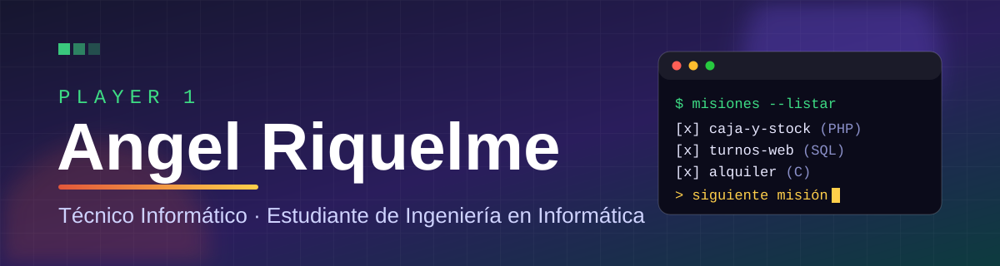

<h1>🎮 Hola, soy Angel 👋</h1>

  <b>Técnico Informático · Estudiante de Ingeniería en Informática</b> 
  📍 De Wanda, viviendo en Posadas, Misiones 🇦🇷 🌿

  
  
  
  

---

## 🧑‍💻 Sobre mí

Me apasiona la tecnología. Empecé por los videojuegos y hoy estudio para construirlos y crear cosas propias. Me gusta aprender rápido, resolver problemas y trabajar en equipo.

Lo que más disfruto es **armar sistemas completos que alguien va a usar de verdad**: pensar qué necesita la persona, escribirlo, construirlo, probarlo y dejarlo funcionando.

Fuera del código: folklore argentino 🪗, videojuegos 🎮 y mis gatos 🐱.

## 🚀 Misiones destacadas

### 🏪 Carnicería Angel · Caja y stock

    

Sistema de **caja y stock para una carnicería con almacén**. Es una aplicación de escritorio portable: una carpeta que se abre con doble clic y **funciona completa sin internet**, en la computadora del local.

- 🧾 Ventas con **lector de código de barras** y etiquetas de balanza, cobro con vuelto, cuatro medios de pago y **cuenta corriente** de clientes
- 📦 Productos por unidad y por peso, calculadora de precio por margen, ingreso de mercadería y ajustes de stock con historial
- 🤝 Proveedores, compras, pagos y deudas; resumen diario de ventas y ganancia; anulaciones con motivo
- 🔐 Usuarios con roles (encargado y cajero): el cajero nunca ve costos ni márgenes
- 🧮 Dinero en **centavos enteros** y pesos en gramos, sin decimales; cada cobro es una transacción única que no se duplica

### 🦷 Sitio web y sistema de turnos para un consultorio odontológico

     

Página para pacientes y panel de administración para una profesional de la salud. Hoy funciona con **datos de prueba**, hasta terminar la revisión legal.

- 📅 El paciente **elige lugar, día y horario**: solo ve los horarios de atención, y los ocupados no se pueden elegir
- 🛡️ Las reglas viven **en la base de datos** (restricciones de exclusión y reglas de acceso por fila), no solo en la pantalla: aunque alguien saltee la página, la base rechaza horarios inválidos u ocupados. Verificado con 40 pruebas
- 🔑 Panel con login, recuperación de contraseña y **copia de seguridad** descargable que se probó restaurando
- ✨ Diseño responsive con movimiento: red de hexágonos animada en canvas, parallax y menú a pantalla completa
- 📜 Aviso de privacidad según la Ley 25.326, sin cookies, tipografías propias y encabezados de seguridad
- ♻️ Despliegue automático en cada cambio y una tarea diaria que evita que la base gratuita se pause

### 🚗 Sistema de alquiler de vehículos

   

Trabajo integrador de **Programación Estructurada**: aplicación de consola en C para gestionar clientes, vehículos, alquileres, devoluciones con demora y pagos, con persistencia en archivos binarios y de texto, y un generador de datos de prueba.

### 🕹️ Proyectos web

| Proyecto | Qué es |
|---|---|
| 🐱 [**Gato Misionero**](https://github.com/W1sar/gato-misionero) · [▶ Jugar](https://w1sar.github.io/gato-misionero/) | Minijuego hecho con HTML, CSS y JavaScript: atrapá mates y pescados, esquivá las piedras |
| 📚 [**entrega-tareas-silicon-misiones**](https://github.com/W1sar/entrega-tareas-silicon-misiones) | Trabajos del curso en JavaScript |
| 🎨 [**qr-code-component**](https://github.com/W1sar/qr-code-component) | Componente de código QR maquetado con CSS |

## 🧭 Cómo trabajo

- 📝 **Primero escribo qué tiene que hacer el sistema** (requisitos y diseño) y después lo construyo
- ✅ **Pruebo antes de publicar**: reglas verificadas con pruebas, incluso las que protegen datos
- 🔒 **Seguridad desde el principio**: sin claves en el código, accesos mínimos y datos de prueba hasta validar
- 🗂️ **Dejo todo documentado** para que otra persona pueda seguir el trabajo

## 🛠️ Inventario (tecnologías)

  
  
  
  
  

  
  
  
  
  

  
  
  

## 🎓 Mi progreso

- 🏫 **Ingeniería en Informática**, Universidad Gastón Dachary (segundo año)
- 💻 **Técnico Informático**
- 🌐 **Desarrollo Web Frontend** (curso de 3 meses)
- 🤖 **Arquitectos e Ingeniería en IA** (cursando)
- 🗣️ **Inglés**, Instituto Sunshine, Wanda

## 🌱 Ahora mismo estoy

- 🎯 Terminando mis primeros sistemas completos: caja y stock para una carnicería, y turnos para un consultorio
- 💬 Diseñando un asistente de WhatsApp para responder las dudas más comunes de un consultorio
- 🧠 Aprendiendo a desarrollar con asistentes de IA: especificaciones primero, pruebas y revisión
- 🔨 Mejorando mi frontend y mi manejo de bases de datos

## 📫 Hablemos

- 🌐 Mi sitio: [w1sar.github.io](https://w1sar.github.io/)
- 💼 Mi portafolio: [claude.ai/artifact/TyC2zHM6P4aMQgVs4AcPzE](https://claude.ai/artifact/TyC2zHM6P4aMQgVs4AcPzE)
- ✉️ angelriquelme573@gmail.com

<i>GAME ON 🎮</i>

